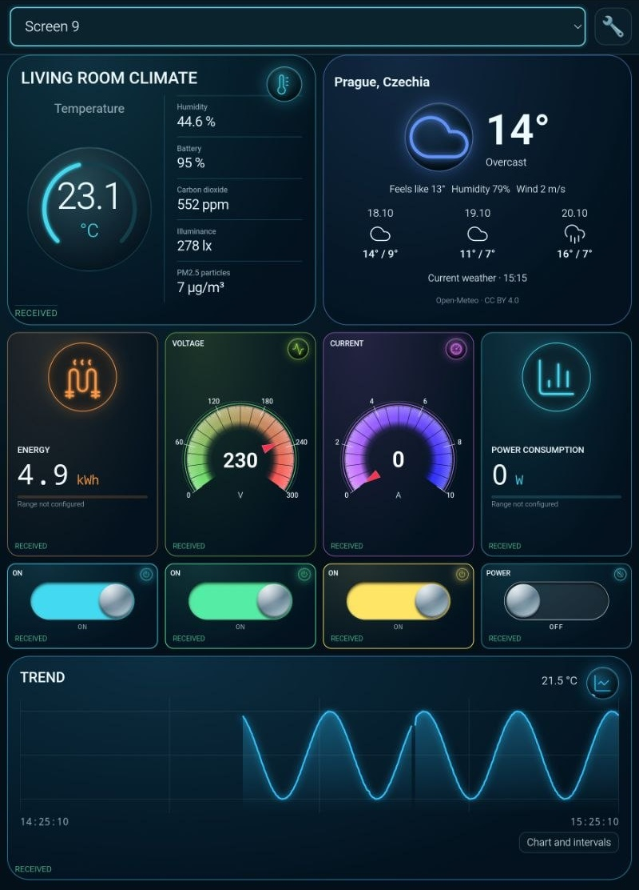
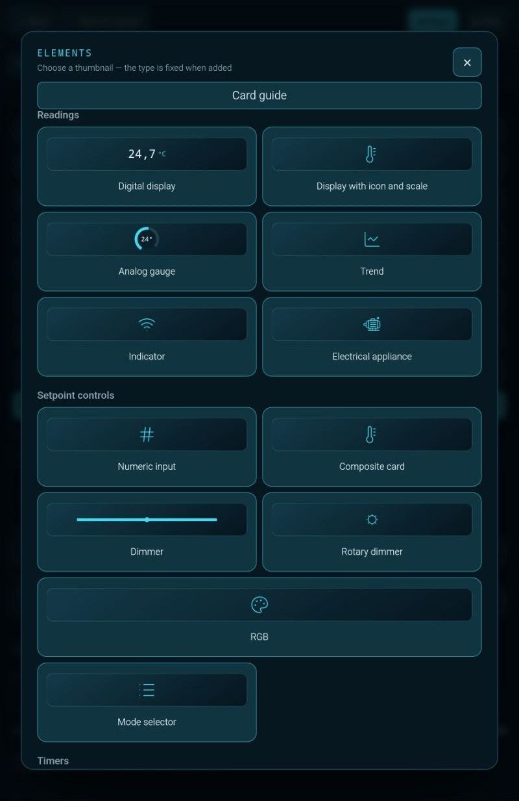

# ARAAMA — Universal HMI Dashboard for Android

Build a tablet panel for your ESP32 sensors, Home Assistant entities and Modbus instruments. Put a room temperature next to a meter reading, plot either value over time and switch a relay from the same screen. A control card shows both the destination of its command and the source of its reported state.

**[Download the Android APK · 0.1.10, build 101](https://github.com/groromario77-collab/ARAAMA-Universal-HMI-Dashboard/releases/download/v0.1.10/ARAAMA-0.1.10-101-release.apk)** · [Release notes](https://github.com/groromario77-collab/ARAAMA-Universal-HMI-Dashboard/releases/tag/v0.1.10) · [All releases](https://github.com/groromario77-collab/ARAAMA-Universal-HMI-Dashboard/releases)

Free app for Android 8.0 or newer. Illustrated PDF guides in [English](https://github.com/groromario77-collab/ARAAMA-Universal-HMI-Dashboard/releases/download/v0.1.10/ARAAMA-User-Guide-EN.pdf), [Russian](https://github.com/groromario77-collab/ARAAMA-Universal-HMI-Dashboard/releases/download/v0.1.10/ARAAMA-User-Guide-RU.pdf) and [Czech](https://github.com/groromario77-collab/ARAAMA-Universal-HMI-Dashboard/releases/download/v0.1.10/ARAAMA-User-Guide-CS.pdf).

[Explore all 14 screenshots](https://groromario77-collab.github.io/ARAAMA-Universal-HMI-Dashboard/gallery/), including seven themes for the same layout, chart history and card settings.

## Connect a data source

| Source | What you can do |
| --- | --- |
| MQTT and ESP32 | Connect to your broker, find a topic and select a plain value or a field from a JSON message. Bind commands and feedback separately. |
| Home Assistant | Import rooms, devices and entities into cards. Combine readings from different connections in one panel. |
| Modbus TCP and Modbus RTU over TCP | Connect to an instrument or a network gateway. Use the register map for your particular meter to choose the value to display. |
| HTTP/REST | Read parameters from an endpoint and select the fields you want on a card. |
| WebSocket and Socket.IO | Display values received in server messages. |

Android also offers local **Pair by M code**. The basic lamp, outlet and sensor flows have been exercised with emulators. Hardware reports are welcome.

## Install and build your first MQTT dashboard

1. Download the APK above and open it on the Android device. If Android asks, allow that browser or file manager to install this APK.
2. In **Settings → Network**, add the MQTT broker your sensor publishes to. Enter its address and credentials, then check the connection.
3. Open **MQTT search** while the sensor is publishing. Select its state topic. For example, if the payload is `{"temperature":21.6,"humidity":48}`, select `temperature` for the first reading.
4. Add a gauge to the screen, bind it to that reading and set the unit to °C. Enable history for the reading and add a trend card. Open **Run** and compare the gauge with the next sensor message.
5. To add a relay, bind the switch command to the topic your device listens to and its feedback to the topic it publishes after switching.

## Two other panels to try

- **Room climate panel.** Import temperature and humidity from Home Assistant, group them on one card and open the temperature history for a selected period.
- **Power meter on a tablet.** Connect a Modbus meter over Ethernet or an RTU-over-TCP gateway. Look up the power register, data type and scale in the manufacturer's manual. Compare the displayed reading with the meter before saving the card.

## Choosing a version and upgrading

For a few MQTT sensors, a chart and a switch, [0.1.5 Beta](https://github.com/groromario77-collab/ARAAMA-Universal-HMI-Dashboard/releases/tag/v0.1.5) remains a lighter option (about 39 MiB). That release addressed freezes and scrolling, improved scanners and composite cards, and corrected scales, icons and translations. Choose 0.1.10 (about 110 MiB) for Modbus, server-message sources or the revised control bindings.

Export your project before upgrading. Build 101 installs over 0.1.5. When moving to a different device, import the project and enter passwords and tokens again.

## Roadmap and feedback

The next area for investigation is local pairing on physical lamps, outlets and sensors. If you try a device, [open an issue](https://github.com/groromario77-collab/ARAAMA-Universal-HMI-Dashboard/issues) with its model, connection method, readings that appeared and how it responded to a command. Reports can guide future compatibility work; there is no announced release date for additional device support.
