# ARAAMA — dashboard examples

Screenshots from a demonstration setup on an Android tablet, captured on 18 October 2026. These examples show screen layouts, themes and configuration; they are screenshots, not importable project files. Values are illustrative and may change between captures. Gauge-editor previews use demo values.

[Download ARAAMA 0.1.5 Beta](https://github.com/groromario77-collab/ARAAMA-Universal-HMI-Dashboard/releases/tag/v0.1.5) · [Report an issue](https://github.com/groromario77-collab/ARAAMA-Universal-HMI-Dashboard/issues)

## One dashboard, seven appearances

The same arrangement of climate readings, weather, electrical readings, switches and a trend is shown below. Labels describe the visible appearance rather than exact in-app theme names.

### Neon dashboard

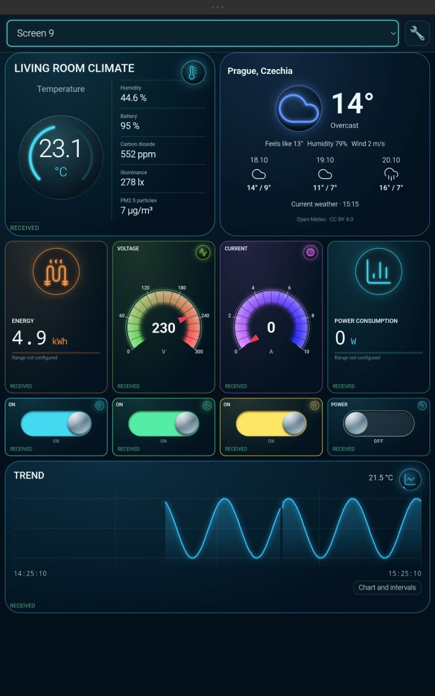

### Dark raised-card appearance

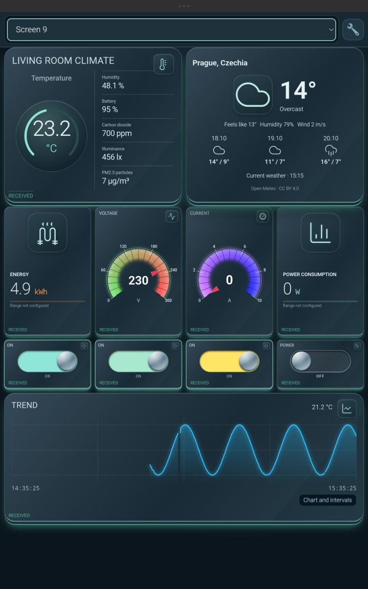

### Dark angular appearance

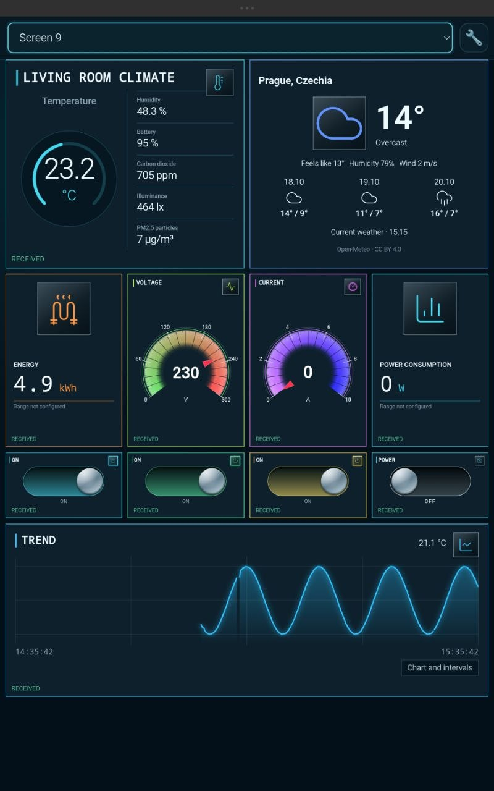

### Dark rounded appearance

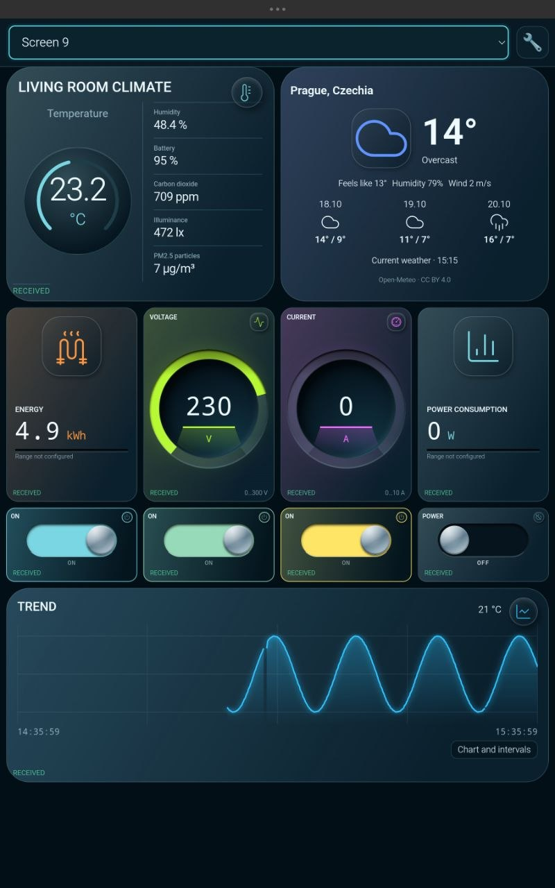

### Warm light appearance

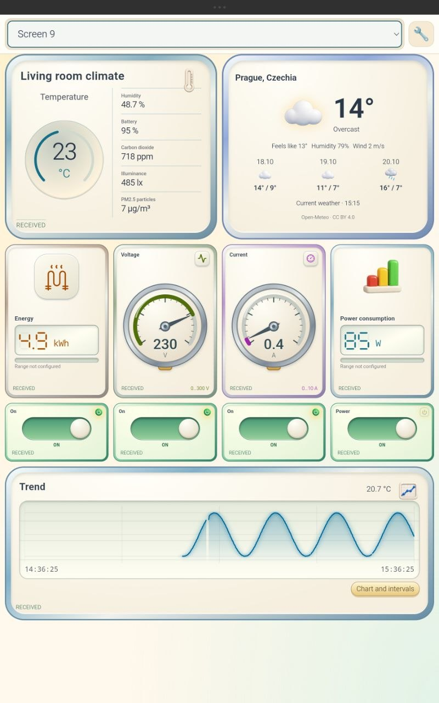

### Metallic appearance

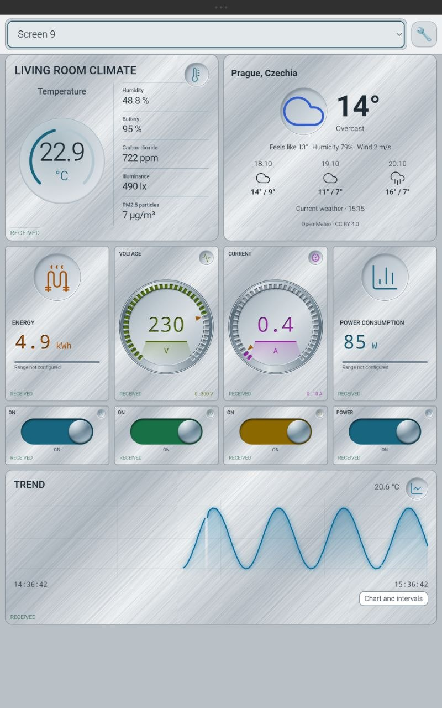

### Soft light appearance

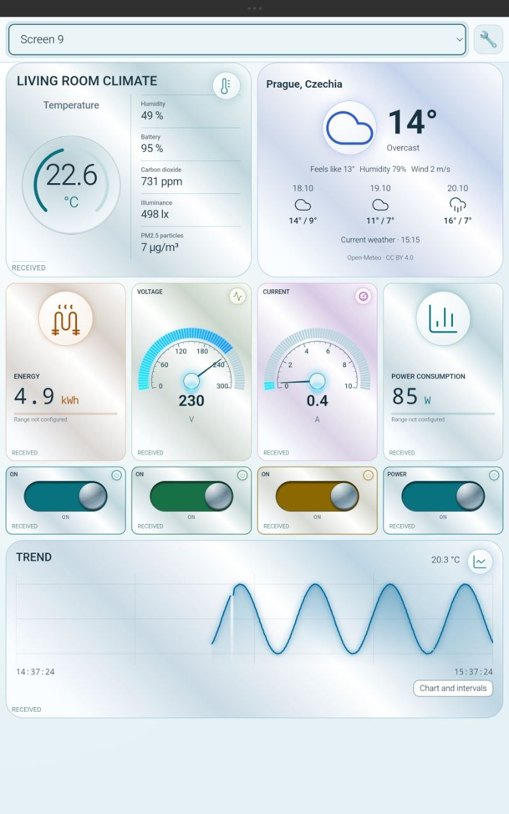

## Layout, history and configuration

### Alternative layout with a wide climate card

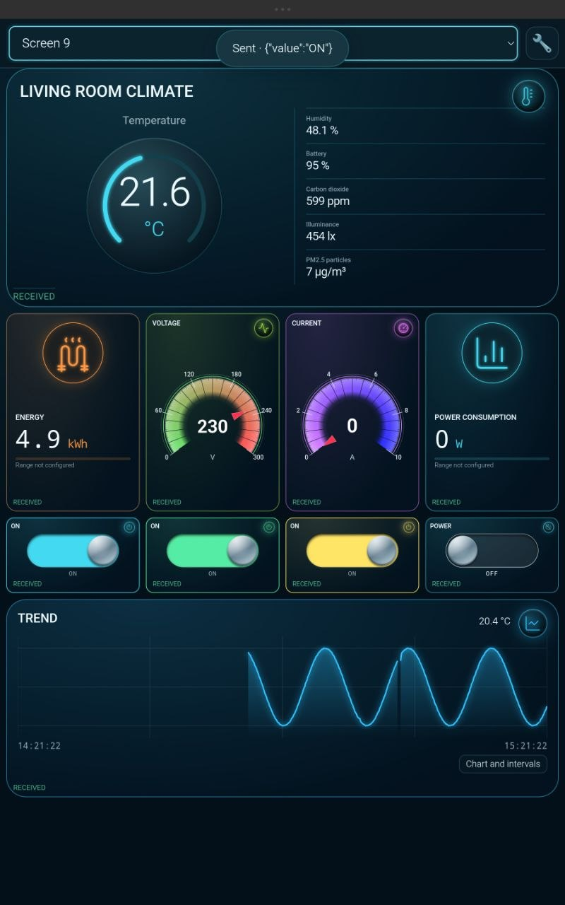

### Temperature history and time cursor

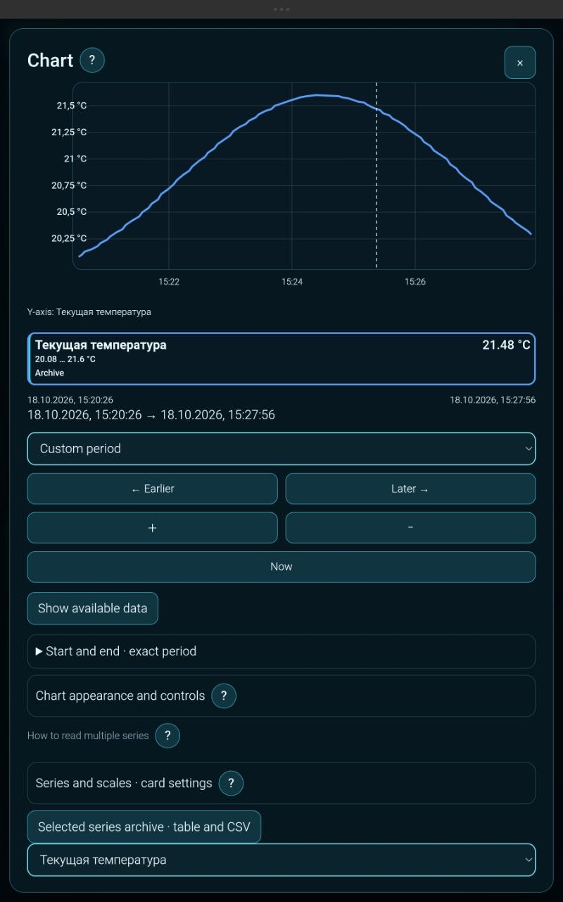

The custom series label “Текущая температура” means “Current temperature”.

### Gauge style selection

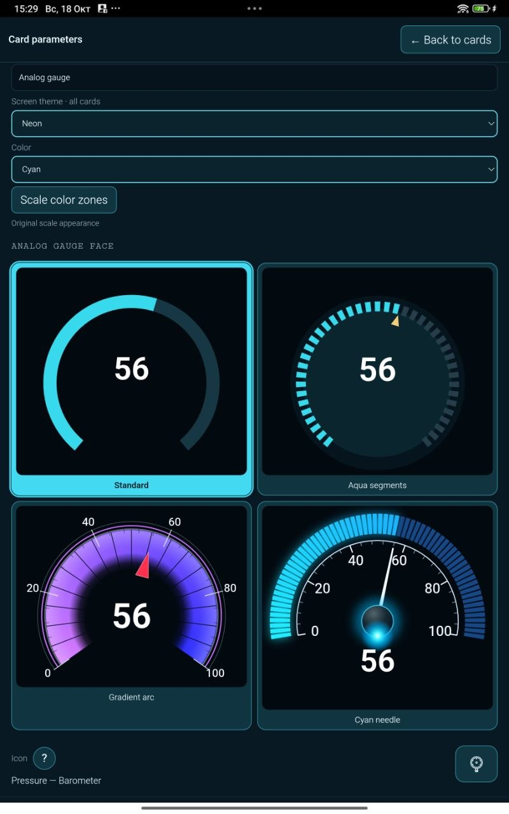

### Element picker: readings and controls

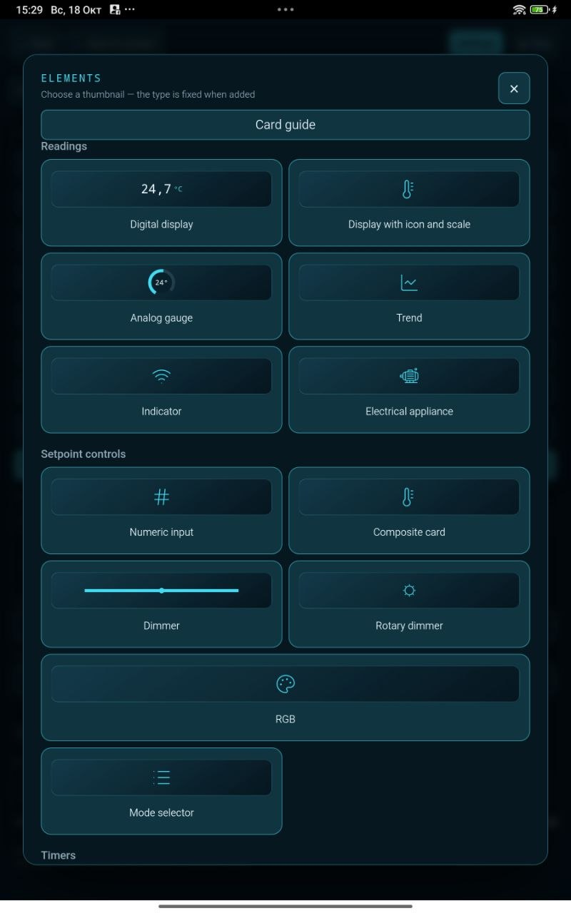

### Element picker: timers, switches and additional elements

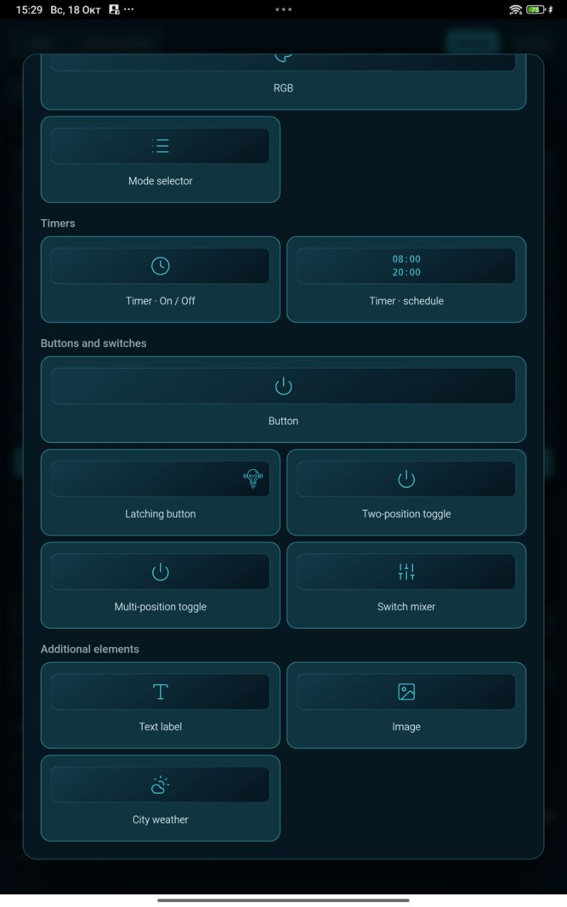

### Card scale and MQTT binding settings

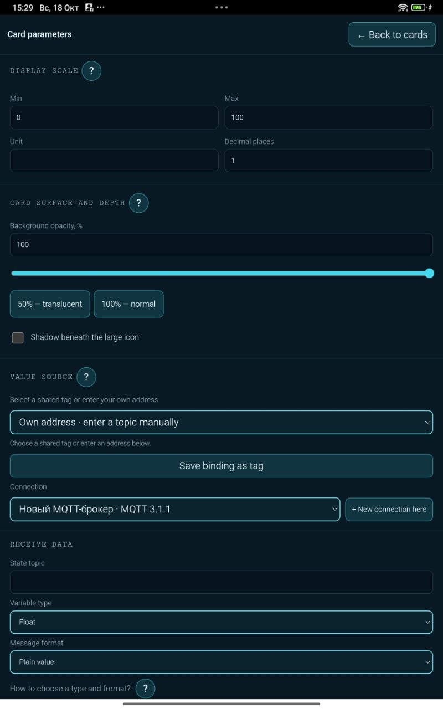

This is an unfinished binding example. The connection label “Новый MQTT-брокер” means “New MQTT broker”; connection credentials are not shown.

### Settings overview

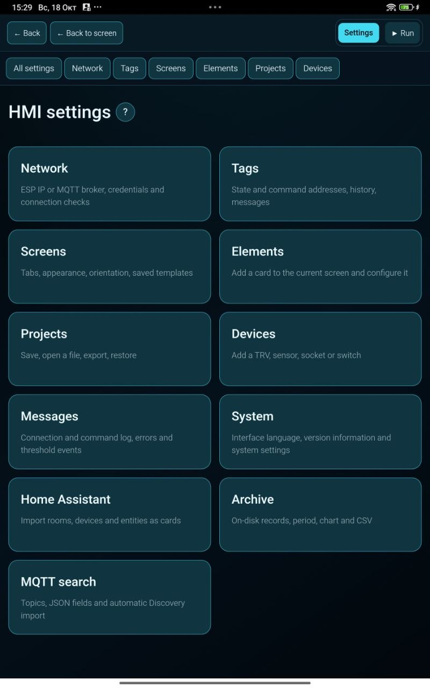

## Импорт и настройка / Import and setup

ARAAMA supports importing rooms, devices and entities from Home Assistant. For MQTT setups, it can discover topics and JSON fields and import supported MQTT Discovery descriptions. The examples above illustrate possible layouts, not compatibility with every device type.

На этой странице собраны все присланные варианты оформления одного демонстрационного экрана, график истории, выбор элементов и настройки. Это снимки экрана, а не файлы проектов для импорта. Названия вариантов описывают их внешний вид.
